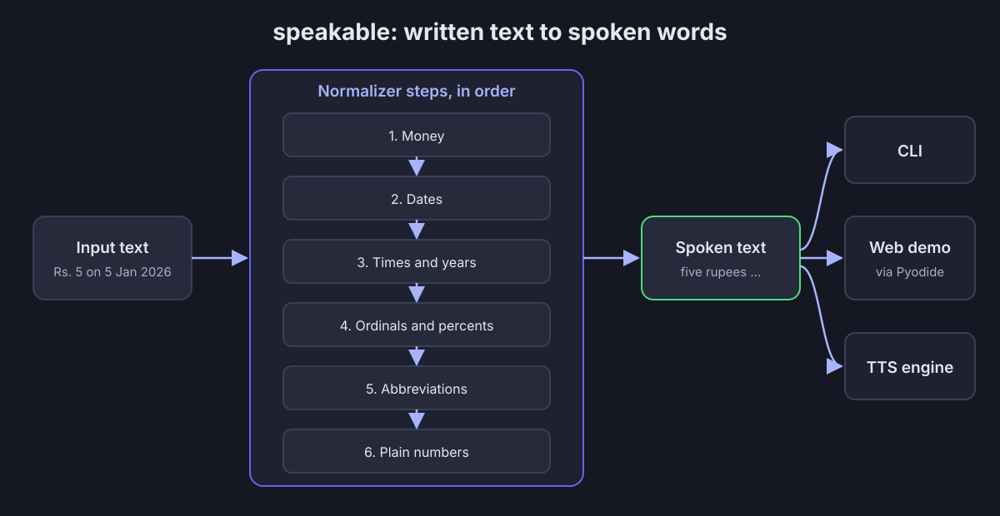

# speakable

A small Python text normalizer that turns written text into the words a text-to-speech voice should say: numbers, money, dates, times, ordinals and abbreviations.


## Example

Input:

```
On 5 Jan 2026 at 9:30 am, Dr. Rao paid Rs. 1,250.50 for the 3rd ticket.
```

Real output of `python3 -m speakable "..."`:

```
On the fifth of January twenty twenty six at nine thirty a m, Doctor Rao paid one thousand two hundred fifty rupees and fifty paise for the third ticket.
```

Add `--explain` to see the before and after of every step, which is handy when debugging what a TTS voice will receive.

## Architecture



## How it works

1. `normalize(text)` runs a fixed list of small step functions, one after the other.
2. Money goes first (`Rs. 1,250.50`), so its digits are not read as a plain number later.
3. Dates (with or without a year), then times, then bare years (`in 2025`), ordinals (`3rd`) and percents (`50%`).
4. Abbreviations (`Dr.`, `km`) come from a readable dictionary.
5. Any digits left over are read as plain numbers (`42`, `-0.5`, `3.14`).
6. Each step uses a small, commented regex, so it can be tested and explained on its own.

## Tech stack

- Python 3.9+, standard library only (`re`, `argparse`, `calendar`, `unittest`)
- A static HTML page that runs the same Python files in the browser with [Pyodide](https://pyodide.org) loaded from the jsDelivr CDN
- Browser `speechSynthesis` for the optional "Hear it" button

## Run locally

```bash
git clone https://github.com/abhidatta-s/speakable.git
cd speakable
python3 -m speakable "On 5 Jan 2026 at 9:30 am, Dr. Rao paid Rs. 1,250.50 for the 3rd ticket."
```

Other ways to use it:

```bash
python3 -m speakable --explain "Rs. 5 at 21:05"     # show every step
python3 -m speakable --system indian "Rs. 12,50,000" # lakh and crore
echo "Dr. Rao" | python3 -m speakable                # read from stdin
```

Web demo: run `python3 -m http.server 8000` from the repo root and open http://localhost:8000/web/ (needs internet access to load Pyodide from the CDN).

## Tests

```bash
python3 -m unittest discover -s tests -v
```

Covered: number edge cases (0, 10, 11, 19, 20, 21, 100, 101, 110, 999, 1000, 1001, 100000, 1000000, 1234567890, the maximum, beyond the range, negatives, decimals, comma-grouped input), the Indian system, ordinals (1st to 111th), INR and USD with and without decimals and singulars, every date format (with and without a year) and year style, bare years after words like `in`, am/pm (including invalid ones like `13:00 pm`) and 24 hour times, abbreviations, full-sentence tests, and the command line.

## Conventions

| Input | Spoken |
| --- | --- |
| `1,250` | one thousand two hundred fifty |
| `-0.5` | minus zero point five |
| `3.14` | three point one four |
| `22nd` | twenty second |
| `101st` | one hundred first |
| `Rs. 1,250.50` | one thousand two hundred fifty rupees and fifty paise |
| `$1` | one dollar |
| `$0.01` | one cent |
| `5 Jan 2026`, `January 5, 2026`, `2026-01-05` | the fifth of January twenty twenty six |
| `05/01/2026` | the fifth of January twenty twenty six (read as DD/MM/YYYY) |
| `22nd Oct`, `Oct 22`, `Oct. 22` | the twenty second of October |
| `5 Jan` | the fifth of January |
| `Oct 22, 2026` | the twenty second of October twenty twenty six |
| `in 2025` | in twenty twenty five |
| `since 1999`, `by 2030`, `until 2005`, `from 1900` | since nineteen ninety nine, by twenty thirty, until two thousand five, from nineteen hundred |
| `2005` (year) | two thousand five |
| `1999` (year) | nineteen ninety nine |
| `9:30 am` | nine thirty a m |
| `9:05 am` | nine oh five a m |
| `12:00 pm` | twelve o'clock p m |
| `13:00 pm` (invalid 12 hour, pm dropped) | thirteen o'clock |
| `21:05` | twenty one oh five |
| `Dr. Rao` | Doctor Rao |
| `50%` | fifty percent |
| `5 km` | five kilometers |
| `Rs. 12,50,000` (with `--system indian`) | twelve lakh fifty thousand rupees |

## Project structure

```
speakable/
  speakable/
    __init__.py
    __main__.py        python3 -m speakable
    cli.py             argparse, --explain, stdin
    normalizer.py      the ordered pipeline of steps
    numbers.py         numbers, ordinals, international and Indian systems
    money.py           INR and USD
    dates.py           four date formats and spoken years
    times.py           12 hour and 24 hour times
    abbreviations.py   readable abbreviation dictionary
  web/index.html       Pyodide demo
  tests/               unittest files, one per module
  assets/architecture.svg
  LICENSE
  README.md
```

## Design decisions and tradeoffs

- Plain functions and small regexes instead of clever tricks, so every line can be read and explained.
- Step order is explicit and documented, because order changes the result (money before plain numbers).
- `05/01/2026` is read as DD/MM/YYYY (Indian convention). US style dates would be read wrongly.
- Digits after a decimal point are read one by one ("three point one four").
- Numbers above 999,999,999,999 raise a `ValueError` in `int_to_words`. Inside `normalize` they are read digit by digit instead, so long IDs still make sense.
- Impossible dates and times (31/02/2026, 25:00) are left unchanged instead of guessed.
- An am/pm on an impossible 12 hour time (`13:00 pm`) is dropped and the time is read the 24 hour way.
- A four digit number from 1900 to 2099 is only read as a year right after in, since, vs., versus, by, until or from. Everywhere else it stays a plain number ("2025 units" is two thousand twenty five).
- The web demo copies the real `.py` files into Pyodide, so there is no second JavaScript implementation to keep in sync.

## Background

This topic connects to my 2017 graduate collaboration with vSpeech.ai, a speech technology company. This repo is a fresh, independent learning project; it is not vSpeech.ai code and has not been used in production.

## Honest limitations

- A prototype, built as a learning and portfolio project in October 2026. It has no real users and is not deployed in production.
- English only, and only INR and USD (symbol must come before the amount).
- `St.` always means Street (never Saint), and units are always plural ("one kilometers").
- Only the date and time formats listed above are recognized. Phone numbers and IDs are read as plain numbers.
- A trailing dot after `a.m.`, `etc.` or a year-less month (`22 Oct.`) is dropped, even at the end of a sentence.
- Year-less dates are guessed from shape: `5 may` in the middle of a sentence is read as a date. Only the first number after `from` is read as a year ("from 2000 to 2005").
- The web demo needs internet access for the Pyodide CDN, and the voice you hear depends on your browser.

## License

MIT. See [LICENSE](LICENSE).
